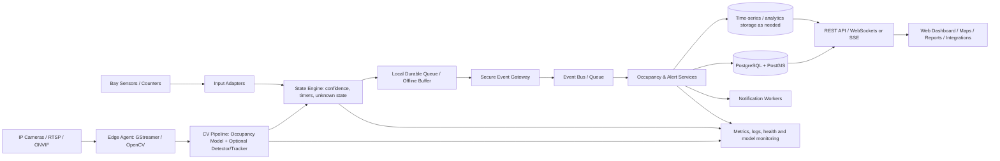

# ParkWise AI — AI-Powered Parking Operations & Analytics

**Product concept and technical solution | Research snapshot: 21 October 2026**  
**Working name:** ParkWise AI (name/trademark availability not checked)  
**Positioning:** An edge-first, privacy-aware parking intelligence platform that turns existing cameras and optional parking sensors into reliable live occupancy, operational alerts, and decision-ready analytics.

> **The core thesis:** Do not sell a flashy object-detection demo. Build a dependable parking operations product. Operators need to know which spaces are available, how trustworthy that answer is, what is changing, what action to take, and whether the system itself is healthy.

---

## 1. Executive recommendation

The supplied idea is a good starting prototype, but it is currently model-led rather than customer/workflow-led. A DETR + YOLO11 combination, temporal smoothing, and a 3D minimap may look impressive, but they do not by themselves produce dependable parking inventory or a product operators can trust.

Build **ParkWise AI** as a modular platform with five connected layers:

1. **Capture:** Existing CCTV/IP cameras, overhead cameras, optional bay sensors, entry/exit counters, and manual operator updates.
2. **Edge perception:** Local video decoding, per-space occupancy classification for fixed views, vehicle detection/tracking when flow analytics are needed, privacy masking, and offline buffering.
3. **Trust and event logic:** Confidence-aware state changes, temporal rules, camera-health monitoring, unknown states, event deduplication, and audit trails.
4. **Parking operations platform:** A live site map, camera/space configuration, alerts, occupancy timeline, staff workflows, facility comparisons, exports, API, and integrations.
5. **Analytics and decision support:** Utilization, turnover, dwell-time estimates, blocked lanes, forecast ranges, anomaly detection, and explainable operational recommendations.

**Do not deploy two detection models on every frame by default.** Pick the least expensive model/pipeline that passes tests on the customer's actual cameras. Use a second model only if measured incremental accuracy justifies the latency, hardware, complexity, and support cost.

### The main technical correction

A general object detector answers questions such as “is there a car in this image?” It does not automatically answer “is bay B-17 free?” For a fixed camera overlooking marked parking spaces, configure polygons or masks for each bay and classify each bay directly; optionally use a vehicle detector as an additional signal. Counting detected cars can fail when cars overlap, bays are occluded, motorcycles are present, or vehicles are parked outside marked spaces. A fixed-bay classifier can be more directly aligned with the business question.

---

## 2. Product vision and value proposition

### The problem

Parking operators often have incomplete or delayed visibility into real capacity. Visitors circle for spaces, staff rely on visual checks, facility managers cannot confidently compare peak periods, and decision-makers may invest in more capacity before understanding how current spaces are used. Camera footage alone is not operational intelligence: it is unstructured video requiring monitoring, configuration, and interpretation.

### The solution

ParkSight converts supported camera feeds and optional sensors into a current parking-space inventory and an auditable history of how the facility is used. Operators can view a facility in real time, understand data freshness, receive actionable alerts, analyze patterns, and share availability through signs or approved APIs.

### Primary customer segments

- **Shopping malls and retail centres:** Visitor wayfinding, peak-time analysis, and tenant/service-zone planning.
- **Hospitals:** Staff/visitor capacity visibility, accessible-bay monitoring, and congestion alerts. Do not use it to manage emergency response without a separate validated safety case.
- **Universities and corporate campuses:** Staff permits, event surges, zone utilization, and shuttle/entry flow.
- **Airports and transport hubs:** Long/short-stay zone utilization and operational reporting; integrations and uptime requirements are higher.
- **Event venues and temporary parking areas:** Rapid lot setup, capacity monitoring, congestion trends, and post-event reporting.
- **Municipal/commercial parking operators:** Portfolio dashboards, performance comparisons, and API feeds to signs or consumer apps.

### Differentiators worth building

1. **Works with existing cameras first:** Minimize new hardware; support mixed camera quality and optional sensors.
2. **Trust-aware availability:** Distinguish free, occupied, reserved, out of service, and unknown/stale instead of treating uncertainty as free space.
3. **Edge-first and low-bandwidth:** Process video locally, send small events/metrics upstream, buffer through outages, and avoid continuous cloud-video uploads.
4. **Camera health is a first-class feature:** Detect frozen feeds, darkness, disconnection, misalignment, excessive blur, and stale data.
5. **Useful for sites with imperfect infrastructure:** Graceful fallback to manual updates and/or sensors, configurable alerts, local caching, and reconnect-safe event delivery.
6. **Evidence behind every KPI:** Let an operator inspect the event/time range and confidence behind a figure, with privacy safeguards.
7. **Vendor-neutral integration:** REST/webhooks and documented event schemas so sites can use their own dashboards, signage, or facility systems.

---

## 3. Users, jobs to be done, and permissions

| User | Main job | Typical permissions |
|---|---|---|
| Platform super-admin | Manage tenants, plans, global configuration, service health | Platform-wide administration; tightly audited |
| Organisation admin | Configure sites, people, integrations, retention, and policies | All sites in an organisation |
| Facility manager | Monitor occupancy and performance; act on alerts | Assigned facilities, reports, staff workflows |
| Parking attendant / security | Check current status, acknowledge alerts, flag errors | Operational view and limited corrections |
| Analyst / executive | Compare periods, export reports, view forecasts | Read-only analytics for permitted sites |
| Integrator / API client | Consume approved availability and metrics | Scoped machine credentials and rate limits |
| Public visitor (optional later) | Find a facility and see recent availability | Only approved, delayed/aggregated public information |

Use role-based access control with **organisation and site boundaries enforced server-side on every request**. A hidden front-end button is not access control. Record privileged changes in an audit log.

---

## 4. Product modules and page-by-page platform

### 4.1 Overview dashboard

Purpose: Answer “What is happening now, and what needs attention?”

- Portfolio occupancy and active capacity.
- Available / occupied / unknown / out-of-service counts shown separately.
- Last-update age and data-quality status beside the headline number.
- Live alerts: feed offline, high occupancy, blocked lane, stale availability, low confidence, sensor disagreement.
- Occupancy timeline and site-by-site comparison.
- “Action required” list with acknowledge, assign, comment, and resolve actions.
- Filters for organisation, site, zone, time window, and input source.

### 4.2 Live map and lot layout

- Geographic map for multiple sites, with MapLibre GL JS or another appropriately licensed mapping stack.
- Select a site to open its calibrated lot plan.
- Colour-coded bay states, with distinct pattern/icon for unknown so colour is not the only signal.
- Camera frustums/coverage, zones, accessible bays, EV charging bays, staff/reserved areas, entry/exit lines, and lane-blocking regions.
- Click a bay to see state, confidence band, last transition, source camera/sensor, and state history.
- 2D plan is the operational default. A 3D minimap is optional visualization, not a core source of truth.
- Configuration mode supports drawing/editing polygons and lines, assigning camera-to-zone relationships, calibrating resolution, testing rule previews, and versioning configuration changes.

### 4.3 Site and camera management

- Register cameras by RTSP/ONVIF where compatible, or use a local connector for network-restricted feeds.
- Configure frame sampling, resolution, ROI/parking-bay polygons, camera orientation, schedule, and retention.
- Display camera online/offline, last frame time, frame rate, inference latency, thermal/resource status where available, and image-quality warnings.
- Guided setup wizard: connect camera → select region → draw bays/lanes → label a small sample → run calibration → validate against human spot checks → enable live output.
- Re-calibration workflow if a camera moves or the scene changes.
- Support a manual source and sensor source when video analytics are unsuitable for a given zone.

### 4.4 Occupancy and parking operations

- Current capacity and bay-state inventory by zone.
- State-change history with confidence and event source.
- Optional reservations/permits integration rather than building a complete payment/reservation platform into the MVP.
- Manual override with reason, expiry, user ID, and immutable audit event.
- Mark a bay blocked, reserved, accessible, EV-only, closed, or under maintenance.
- Reconcile camera inference with bay sensors, entry/exit counters, or staff confirmation.
- Avoid presenting an inferred count as an exact truth when visibility or sensor coverage is poor.

### 4.5 Alerts and workflows

Configurable examples:

- Zone exceeds an occupancy threshold for a specified duration.
- A lane or access route is obstructed for more than N seconds.
- A monitored bay has remained unknown for too long.
- Camera feed goes offline, freezes, becomes dark, or changes view.
- Two sources disagree on a bay state.
- Occupancy changes unusually fast relative to recent patterns.
- A forecast suggests the site may reach capacity in the next 15–60 minutes.

Each alert needs severity, site/zone, opened time, supporting metadata, assignee, acknowledgement, resolution, cooldown/deduplication, and delivery status. Channels can include dashboard, email, SMS, and WhatsApp via approved providers. Respect opt-in, local regulations, and messaging-provider rules. Do not send one message per frame or transition burst.

### 4.6 Analytics and reports

- Occupancy by site/zone/day/hour.
- Utilization over a time window.
- Vehicle arrival/exit counts when virtual-line counting is configured.
- Turnover rates and dwell-time estimates with explicit definitions and coverage caveats.
- Peak/quiet-hour comparisons and event-day reports.
- Accessible/EV/reserved-zone usage if the bay type is configured and the use case is authorized.
- Camera/model quality metrics alongside business KPIs.
- CSV export and scheduled PDF/email reports.

### 4.7 Forecasts and recommendations

Start with trustworthy baselines, not a complicated AI model by default:

1. Median occupancy for the same day of week and time window.
2. Seasonal-naive or rolling-window baseline.
3. Gradient-boosted regression/quantile model when sufficient historical data exists, with weather, calendar, and event inputs only where authorized and useful.
4. Evaluate against the baseline by site and horizon; show a prediction interval and “low confidence” when data is sparse.

Example recommendation: “North zone is projected to exceed 90% occupancy between 10:30 and 11:00, based on the last 8 comparable weekdays. Confidence is moderate.” The platform should explain which data supported the suggestion. Operators make the final operational decision.

### 4.8 Integrations and developer portal

- Documented REST API and webhooks for current occupancy, historical aggregates, alerts, camera health, and bay-state changes.
- API keys/service accounts scoped to a tenant and site, with rotation, expiry, rate limits, and audit logs.
- Digital signage feed, website widget, navigation/wayfinding systems, facility-management software, and permitted access-control systems.
- MQTT or an equivalent lightweight transport between edge devices and the cloud service where appropriate.
- Idempotency keys and delivery acknowledgements to avoid duplicate events after reconnect.

### 4.9 Administration, support, and billing (commercial release)

- Tenants, sites, plans, usage caps, retention choices, user invitations, identity settings, and audit export.
- Model and edge-agent version inventory, staged rollouts, rollback, health checks, and support bundles.
- Status page and incident log.
- Pricing can later be based on monitored bays, camera streams, site count, retention, and service level—not on raw detection count.

---

## 5. Computer-vision and AI design

### 5.1 Choose the pipeline by camera/view type

**Mode A — Fixed cameras with marked spaces (recommended MVP):**

- Draw a polygon/mask for every bay during setup.
- Sample frames at an appropriate rate, not necessarily every decoded frame.
- Use per-space crop classification or a suitable segmentation/detection model to decide if the bay is occupied.
- Optional vehicle detector helps identify vehicles crossing bay polygons or diagnose disagreement.
- Apply per-bay state-transition logic and confidence handling.
- This approach maps the model output directly to the operator's question: “What is the state of each bay?”

**Mode B — General overhead / aerial / wide scene:**

- Vehicle detector (candidate families: current YOLO26 variants, RT-DETR-family models, or another licence-compatible detector) plus a multi-object tracker.
- Use calibrated regions, line crossings, and zone rules for counts and flow.
- For exact bay occupancy, map detections back to bay geometry and account for occlusion/overlap; do not infer it from a facility-wide count alone.
- Do not assume an aerial-tuned model automatically transfers to a fixed oblique CCTV camera. Viewpoint, scale, lighting, weather, local vehicle types, and image compression all matter.

**Mode C — Mixed camera/sensor fleet:**

- Normalize all inputs to a common event/state schema.
- Fuse sources with explicit source priority, freshness, and disagreement handling.
- A sensor reading does not automatically overrule a camera; the priority policy is configurable and visible.

### 5.2 Recommended model-selection approach

As of the research snapshot, Ultralytics documents YOLO26 as its newest real-time model family, released in January 2026, with end-to-end inference and multiple task heads. RT-DETR and later RT-DETR variants remain candidates for benchmarking. NVIDIA DeepStream 9.2 documents production-oriented video analytics pipelines for supported NVIDIA GPUs and Jetson platforms. Those facts make them candidates—not automatic winners for this dataset. Benchmark the actual task and cameras on the intended device.

Evaluate:

- **Accuracy:** Per-bay occupied/free precision and recall, false-free rate, false-occupied rate, and unknown-state rate.
- **Robustness:** Night, glare, rain, shadows, headlights, dirty lens, compression, occlusion, different vehicle types, and camera movement.
- **Operations:** End-to-end latency, throughput across concurrent streams, RAM/VRAM, power, thermal behavior, reconnect recovery, and cost per monitored bay.
- **Lifecycle:** Dataset and weight licence, commercial-use requirements, supportability, export/runtime compatibility, and ease of re-training.

Do not compare model families only by published COCO mAP or FPS; those values do not tell you which one is best at correctly deciding whether a partially occluded parking space is free.

### 5.3 Anti-flicker logic should be stateful and inspectable

Use a per-bay state machine, not a blanket smoothing filter. An illustrative design:

1. Each observation has a class/probability, timestamp, source, and quality metadata.
2. Require a configurable evidence rule—such as K consistent observations within T seconds or a calibrated cumulative score—before changing a stable state.
3. Use different entering/leaving thresholds if validation shows hysteresis reduces flicker without delaying genuine changes.
4. If the camera goes stale, the scene is obscured, or confidence stays low, move the bay to **unknown** after a configured timeout rather than indefinitely coasting a stale “free” state.
5. Emit one idempotent `bay_state_changed` event with the prior state, new state, rule version, confidence band, and event timestamp.
6. Measure the latency and error introduced by the smoothing rule. Too much coasting makes the display look stable while becoming wrong.

The initial product must treat **unknown** as a valid state. Do not silently convert unknown to free.

### 5.4 Tracking, dwell, and turnover

A tracker (e.g., ByteTrack/BoT-SORT-family implementation, or the tracker offered by the selected inference stack) helps link a moving vehicle across nearby frames. Tracking IDs are generally local and temporary; cross-camera identity matching should not be a default requirement.

- **Slot dwell:** Compute from the confirmed occupied interval of a defined bay. This can work without identifying the same vehicle across cameras.
- **Vehicle dwell:** Estimate only when entry/exit or bay association is sufficiently observable. Explain gaps caused by occlusion, camera blind spots, and tracking resets.
- **Turnover:** Define it before displaying it. Example: completed occupancy sessions per active bay per hour, or vehicle exits per zone per hour. These are not interchangeable.
- **Lane blockage:** Configure a lane polygon or access region; detect presence/overlap and duration; tune for legitimate queues, loading zones, and stopped traffic to reduce false alerts.

### 5.5 3D visualization recommendation

Retain the 3D activity minimap as an optional presentation mode if users enjoy it, but make the calibrated 2D lot plan, current bay state, event timeline, and source health the primary tools. A 3D scene can communicate density; it should not obscure uncertain data or be treated as a more accurate operational representation.

### 5.6 Data strategy and model lifecycle

- Collect customer-approved, purpose-limited image samples across daylight/night/weather/season and different vehicle types.
- Label each bay or vehicle with a documented protocol; record ambiguity and occlusion.
- Split evaluation data by camera/site and time, not only by random image, to reduce leakage from near-identical adjacent frames.
- Use public parking datasets (for example, PKLot and CNRPark-EXT) as development baselines only after verifying access terms and whether camera conditions match the deployment.
- Keep a versioned dataset manifest, annotation guide, train/validation/test split, model card, benchmark results, and licence record.
- Capture hard examples for review only when authorized; prefer cropped, masked, low-retention samples.
- Monitor unknown rates, confidence distributions, disagreement rates, and a small sample of human-verified state accuracy to identify drift.
- Use MLflow or a comparable tool for experiment/model lineage; make model rollout staged, measurable, and reversible.

### 5.7 Generative AI: optional, not the foundation

A grounded natural-language analytics assistant can be a later feature, for example: “Compare weekday occupancy in the north and south zones this month.” It should translate a restricted request into approved metrics/query templates, show the selected filters, and link to the underlying report. It must not invent figures, issue access-control commands, or treat camera video as unrestricted conversational context. Use conventional analytics for the core product first.

---

## 6. Proposed technical architecture



### 6.1 Edge / inference layer

- **Python** for model evaluation and initial CV services; use **GStreamer/OpenCV** for ingest and pre/post-processing.
- **NVIDIA deployment option:** NVIDIA DeepStream + TensorRT on supported Jetson or discrete-GPU hardware. DeepStream is a good candidate for multi-stream video pipelines; test exact release/device/runtime compatibility before locking the bill of materials.
- **Portable alternative:** PyTorch/ONNX Runtime on CPU or supported accelerators for development and non-NVIDIA customers.
- Containerize the edge agent, pin model and runtime versions, use health probes, signed/verified configuration where feasible, and support remote rollout/rollback.
- Run inference at a task-appropriate sample rate. More frames are not always more value; bay state may only require a few observations per second, while some flow analytics need higher temporal resolution.
- Local buffering supports brief network loss. The edge agent should emit event timestamps and deduplicate after reconnect.

### 6.2 Backend and storage

**Recommended first production stack:**

- **API/business services:** Python + FastAPI, Pydantic schemas, OpenAPI-generated docs.
- **Database:** PostgreSQL, with PostGIS when geographic/site geometry is needed. Store current state relationally and append state-change events for history/audit.
- **Time-series strategy:** Begin with PostgreSQL indexes/partitioning and sensible retention; add TimescaleDB or analytical OLAP storage only when volume/query benchmarks justify another component.
- **Cache/live state:** Redis only where real measured latency or pub/sub needs justify it; do not make the cache the only durable record.
- **Queue/event bus:** Start with a managed queue or Redis Streams/NATS-class option suited to the pilot; consider Kafka/Redpanda when scale, replay, or multi-consumer needs justify the operational burden.
- **Object storage:** S3-compatible storage for approved exports, reports, and short-lived diagnostic clips only if needed. Default to not storing continuous raw video in the cloud.
- **Background jobs:** A worker system for reports, exports, alert delivery, forecast refreshes, and retention cleanup.

### 6.3 Frontend

- **Next.js + React + TypeScript** for a modern responsive web application.
- **Tailwind CSS + a vetted component system** for consistent, accessible UI.
- **MapLibre GL JS** for an open-source WebGL map, subject to map tile/source terms and attribution requirements.
- **Charts:** ECharts, Recharts, or another accessible charting library; ensure tables and text summaries exist for users who cannot interpret charts.
- **Live updates:** WebSockets for interactive streams where needed, or Server-Sent Events for simpler server-to-browser event flows.
- **PWA support** can improve the utility of the operator interface on mobile devices, but do not promise reliable offline video analytics through the browser; edge processing belongs on a local agent/device.

### 6.4 Identity and security

- Use a reputable OIDC provider or a well-maintained identity library; support MFA for administrators.
- Server-side tenant/site authorization on every object, API-key scopes, short-lived tokens, secure secret storage, rate limiting, request validation, CSRF protection where applicable, and strict CORS/CSP.
- Encrypt traffic with TLS and encrypt stored data using platform facilities.
- Keep secrets out of source control; rotate credentials; redact tokens and sensitive fields from logs.
- Add audit events for user sign-in events, role changes, camera configuration, overrides, exports, integrations, and retention-policy changes.
- Threat-model camera credentials, RTSP access, edge-device compromise, malicious uploads, cross-tenant data leakage, event replay, and webhook spoofing.
- Use the OWASP API Security Top 10 as a baseline for API threat review, especially object-level authorization and broken authentication.

### 6.5 Observability and reliability

Measure separately:

- Video freshness and frames received per camera.
- Decode/inference/post-processing latency, FPS, device resource usage, queue depth, dropped frames, and reconnect counts.
- Per-bay state changes, unknown-time percentage, confidence distribution, sensor disagreement, and sampled human-audit accuracy.
- API latency/error rate, database load, event lag, webhook success, notification delay, and backup/restore tests.

Use OpenTelemetry-compatible traces/metrics/logs plus a monitoring stack such as Prometheus/Grafana where appropriate. Alert on system health as well as parking conditions.

---

## 7. Core data model

A reasonable starting relational model:

- `organisations`: tenant identity, plan, retention policy, settings.
- `users`, `memberships`, `roles`: identity and tenant/site scope.
- `sites`: location, timezone, metadata, organisation ID.
- `zones`: site geometry, zone type, enabled capacity.
- `cameras`: connection reference/secret pointer, position, configuration version, last-seen time, health status.
- `bays`: bay label, polygon/geometry, type, active/out-of-service state, zone ID.
- `sensors`: sensor identity, bay/zone mapping, protocol, calibration, health.
- `bay_state_current`: latest normalized state, confidence band, source, last observation, stale/unknown reason.
- `bay_state_events`: append-only prior/new state, timestamps, rule/model/config versions, event ID, source, confidence metadata.
- `vehicle_track_events` (only if needed): ephemeral track ID, zone/line events, timestamps, no identity inference by default.
- `alerts`, `alert_events`, `acknowledgements`: lifecycle, assignment, severity, delivery status, resolution reason.
- `integrations`, `api_credentials`, `webhook_deliveries`: encrypted credential references, scopes, retries and expiry.
- `audit_logs`: actor, action, resource, timestamp, request context, before/after references where appropriate.
- `model_versions`, `edge_agents`, `deployments`: model/runtime health and rollout history.

Store derived aggregates for the product's most common queries. Avoid rebuilding every dashboard view from raw video or millions of raw per-frame detections.

### State semantics

Use a controlled enum, for example:

`FREE | OCCUPIED | UNKNOWN | RESERVED | OUT_OF_SERVICE`

`UNKNOWN` should include a reason such as `CAMERA_OFFLINE`, `STALE_FRAME`, `LOW_CONFIDENCE`, `OBSCURED`, or `SOURCE_CONFLICT`. A reserved bay may still be physically occupied; where that distinction matters, keep physical occupancy and operational availability as separate dimensions rather than forcing both into one enum.

---

## 8. API design examples

Version the API from the start, for example under `/api/v1`.

- `GET /api/v1/sites` — sites the caller is authorized to view.
- `GET /api/v1/sites/{site_id}/summary` — capacity, occupancy, unknown count, source freshness, and update timestamp.
- `GET /api/v1/sites/{site_id}/bays` — bay state/geometry, with access checks and pagination.
- `GET /api/v1/sites/{site_id}/events?from=...&to=...` — authorized event history.
- `GET /api/v1/sites/{site_id}/analytics/occupancy?interval=15m` — aggregated data.
- `POST /api/v1/alerts/{alert_id}/acknowledge` — acknowledge an alert.
- `POST /api/v1/bay-overrides` — create a time-limited, reason-coded operator override.
- `POST /api/v1/edge/events` — authenticated edge-to-cloud event ingest with idempotency.
- `GET /api/v1/health/summary` — health visible only to authorized operations users.
- `POST /api/v1/webhooks/test` — test configured delivery, permission-scoped.

For each endpoint define schemas, pagination, filtering, error codes, rate limits, versioning, scopes, idempotency, and a contract test. Never trust tenant/site IDs supplied by the browser without rechecking access on the server.

Example event payload (illustrative):

```json
{
  "event_id": "evt_01J...",
  "event_type": "bay_state_changed",
  "schema_version": 1,
  "organisation_id": "org_example",
  "site_id": "site_example",
  "bay_id": "bay_B17",
  "previous_state": "UNKNOWN",
  "new_state": "OCCUPIED",
  "confidence_band": "HIGH",
  "observed_at": "2026-10-21T09:14:12Z",
  "model_version": "occupancy-v0.3.1",
  "config_version": 12,
  "source": "edge_camera_03",
  "idempotency_key": "site_example:bay_B17:12:..."
}
```

Use opaque IDs in production examples, validate timestamps, and document that the confidence band is a model output—not a guarantee of truth.

---

## 9. Metrics and their definitions

A KPI should have a precise numerator, denominator, time basis, and quality caveat.

| KPI | Practical definition | Important caveat |
|---|---|---|
| Current occupancy | Confirmed occupied active bays / active monitored bays | Report unknown bays separately; disclose denominator and freshness |
| Availability | Confirmed free bays / active monitored bays | Do not count unknown as free |
| Time utilization | Occupied bay-minutes / monitorable active bay-minutes | Exclude out-of-service periods using an explicit policy |
| Zone arrivals | Valid inward line-crossing events per interval | Requires calibrated virtual line and a validated crossing rule |
| Turnover | Explicitly defined completed parking sessions per bay/hour or exits per zone/hour | Name the definition in UI; different definitions give different answers |
| Slot dwell | Duration of each confirmed occupied interval | Split/mark intervals where the camera went stale or the state was uncertain |
| Lane blockage | Duration a configured lane polygon is obstructed beyond a threshold | Tune to ignore legitimate short queues and designated loading activity |
| Forecast error | MAE/WAPE or another selected metric per horizon/site | Compare with a simple baseline and show sample size/uncertainty |
| System availability | Time the feed and state service meet defined freshness/uptime thresholds | Separate camera outage from backend outage |
| State accuracy | Human-audited precision/recall and false-free rate on a defined sample | Audit by camera, time-of-day, weather, and bay type |

**A useful pilot objective is to prove quality rather than promise a universal accuracy number.** Establish a labelled evaluation set and agree thresholds with each customer. False-free errors can cause more frustration than an honest unknown state, so track them separately.

---

## 10. Privacy, legal, and responsible-AI controls

Parking video may capture people, license plates, nearby roads, and sensitive location patterns. Treat it as potentially personal data.

- Prefer edge inference and event/aggregate upload over continuous cloud video transmission.
- Define a lawful purpose, signage/notice, retention periods, access rules, and responsibilities with the customer before installation; evaluate the Kenya Data Protection Act, 2019 and all applicable local requirements with qualified counsel.
- Mask or blur faces and license plates if captured, particularly in retained diagnostic images. Do not build automatic number-plate recognition into the default MVP.
- Avoid identity tracking, cross-camera re-identification, or individual profiling unless a separate legitimate, reviewed use case requires it.
- Keep raw diagnostic frames only when necessary, access-controlled, and time-limited; log viewing and export where appropriate.
- Use aggregated public availability by default; avoid revealing security-sensitive patterns or staff-specific parking behavior.
- Clearly mark inferred versus sensor-confirmed data, data freshness, and uncertainty.
- Never use the CV model to make punitive decisions about people or vehicles without independent validation, lawful authority, and human review.
- Perform a privacy impact assessment when the deployment's risks warrant it; document vendor/subprocessor and data-transfer arrangements.

---

## 11. Deployment strategy and operating modes

### Pilot / low-cost proof of concept

- 1 site, 1–3 fixed cameras, manually configured bay polygons, dashboard, current state, history, camera-health signal, and a small alert set.
- Run inference on a development workstation or a modest suitable edge device; measure actual workloads before choosing hardware.
- Use Docker Compose for the pilot backend, database, UI, and worker services. Keep the edge agent separately deployable.
- Include a labelled video sample and a test harness so development is repeatable without needing live access at every test.

### Small production site

- On-premise or local edge GPU/accelerator if video volume warrants it; secure outbound connection to the cloud/API.
- Tenant-scoped web application, backups, monitoring, access controls, alert delivery, edge offline buffering, and documented support process.

### Multi-site / enterprise

- Central fleet/tenant administration, staged model rollouts, stronger identity controls, formal SLOs, disaster recovery, queue replay, rate limits, observability, and capacity testing.
- Use a message broker and analytical store only when measurements show they are needed.
- For high-availability/24×7 GPU deployments, validate the exact hardware/software stack and use hardware designed and supported for the target workload.

### Reliability scenarios to test

- Internet outage while cameras remain available.
- Camera disconnection, frozen frame, password rotation, and RTSP reconnect.
- Edge device restart/power loss and local queue replay.
- Clock drift, duplicated/out-of-order events, and delayed webhook delivery.
- Camera angle change, construction, faded bay markings, headlight glare, night/rain, and partial occlusion.
- Database restore, model rollback, alert-provider failure, and expired API credential.

---

## 12. MVP scope and phased roadmap

### Phase 0 — Validate the use case (1–2 weeks)

- Interview 5–10 parking/facility operators and observe how they currently count/communicate availability.
- Select one target type of parking site and one camera viewpoint.
- Obtain permission for a small representative sample; write a privacy and retention plan.
- Define bay-state labels, alert rules, measurement protocol, and business success criteria.

**Exit gate:** There is a named operator, a legal/authorized sample source, a specific operational workflow, and agreement on what counts as a correct bay state.

### Phase 1 — Working CV prototype (2–3 weeks)

- Video ingest from file/RTSP, polygon-based bay layout, per-bay state estimator, unknown/stale logic, and event log.
- Compare one strong compact detector/segmenter or crop classifier against one alternative only if needed.
- Build an offline evaluation harness and report false-free rate, precision/recall, latency, and conditions causing failure.

**Exit gate:** The state estimator performs acceptably on a site/time-separated test sample and exposes failure states rather than silently guessing.

### Phase 2 — Operator dashboard (2–3 weeks)

- Sign-in and permissions, site overview, live lot plan, bay status, historical chart, camera health, event list, manual corrections, and CSV export.
- API events with authentication, idempotency, and tenant-level authorization tests.

**Exit gate:** A facility manager can use it to answer “How many bays are confidently available, how fresh is that answer, and which cameras/areas need attention?”

### Phase 3 — Alerts and resilient edge deployment (2–4 weeks)

- Edge agent packaging, local queue/reconnect, health monitoring, selected alerts, email/SMS/WhatsApp provider integration, and runbook.
- Pilot in shadow mode first: compare against human counts before sharing data as authoritative.

**Exit gate:** The system recovers from realistic failures, alerts do not spam, and operators trust the displayed data quality.

### Phase 4 — Analytics and multi-site product (4–8 weeks after pilot)

- Zone trends, utilization, turnover/dwell definitions, report scheduling, roles, tenant configuration, model versioning, and integration documentation.
- Add forecast baselines and a model only when there is sufficient history and demonstrated lift against baseline.

### Phase 5 — Commercial hardening

- Security test, privacy review, backup/restore drills, device fleet management, staged updates, support/SLO process, performance benchmark, licence audit, customer onboarding, and pricing validation.

*Timing is a planning estimate for a focused team, not a delivery guarantee. Camera access, labelling, integrations, procurement, and compliance can dominate the schedule.*

---

## 13. Testing and acceptance checklist

### Computer vision

- [ ] Test set includes complete days and different times of day from held-out cameras/site periods.
- [ ] Measure per-bay precision, recall, false-free rate, unknown rate, and transition delay.
- [ ] Test shadows, glare, rain/night, reflections, occlusion, motorcycles, unusual parking, camera movement, and poor compression.
- [ ] Verify unknown/stale behaviour and avoid unlimited coasting.
- [ ] Verify detection/tracking counts do not double-count objects after track resets.

### Product and workflow

- [ ] Site map and bay state match configured geometry.
- [ ] Manual override includes reason, actor, start/expiry, and audit log.
- [ ] Alerts have deduplication, acknowledgement, escalation/expiry policy, and delivery status.
- [ ] Exported KPIs use the same definitions as the dashboard.
- [ ] All pages work on laptop/tablet and are usable with keyboard/screen-reader support where feasible.

### Security and operations

- [ ] Users cannot read another organisation's site or event by changing an ID.
- [ ] Secrets never appear in logs or client code.
- [ ] Edge agent buffers locally and safely resends events after reconnect.
- [ ] Camera-health failures are visible even when occupancy is unchanged.
- [ ] Backups can be restored and model/config rollbacks are tested.
- [ ] Retention and deletion rules are tested, not merely documented.

### Release criteria

Do not claim “real-time,” “accurate,” or “production-ready” without defining the supported hardware, stream count, data freshness target, measured workload, test conditions, and failure behaviour. Publish a site-specific performance report for pilots.

---

## 14. Monetization and go-to-market hypotheses

Validate these with operators rather than assuming them:

- **Pilot fee:** Installation/configuration plus a short validation period.
- **SaaS subscription:** Per active bay, camera stream, or site tier, with limits for retention and reporting.
- **Enterprise/on-premise:** Annual licence/support for customers with strict networking, security, or uptime needs.
- **Add-ons:** Forecasting, public availability API, digital signage integration, advanced reporting, and managed hardware/maintenance.

Start with one use case and a measurable economic outcome—e.g., less manual counting, quicker identification of full zones, better allocation of spaces, or fewer unnecessary searches. Do not claim quantified savings until a pilot measures them. Build partnerships with camera installers, parking operators, property managers, and facility integrators.

### Key commercial risks

1. Customers may expect parking/payment/access control that this product does not provide. Define boundaries and integrations clearly.
2. Camera geometry and site-specific labelling can make onboarding expensive. Invest early in calibration tools and repeatable deployment.
3. Operators may not trust inaccurate availability. Show uncertainty and let them correct errors; measure false-free events.
4. Cheap cameras, unreliable power/connectivity, and different vehicle mixes can reduce performance. Design for degraded modes from day one.
5. Open-source model and dataset licences can affect commercialization. Conduct a legal/engineering licence review before selecting the final stack.

---

## 15. Recommended initial build: precise scope

For the first demonstrable version, build exactly this:

1. One fixed-camera parking scene with 30–150 configured bays (the actual count depends on image quality and visibility).
2. A calibration tool for drawing and naming bay polygons.
3. Occupied/free/unknown state per bay, with freshness and a confidence band.
4. A 2D lot map and portfolio summary with current counts.
5. Event history and occupancy-by-time chart.
6. Camera online/stale/frozen status.
7. Three alerts: high occupancy, blocked lane (only if a lane zone is configured), and stale camera/data.
8. Role-controlled operator login, manual override with audit trail, CSV export, and a small REST API.
9. Edge video processing with local buffering and no default continuous raw-video cloud storage.
10. Automated evaluation report comparing model predictions with a human-labelled test sample.

**Defer:** mandatory DETR+YOLO dual inference, elaborate 3D rendering, license-plate recognition, payments, reservations, cross-camera identity, a chatbot, and complex deep-learning forecasts. Add them only when customer evidence shows they solve a real need.

---

## 16. Decisions to make before coding

- Are the first cameras fixed CCTV with clearly visible individual bays, or overhead/aerial views?
- How many cameras and bays must run concurrently on target hardware?
- Is the customer's priority live bay availability, vehicle flow, or both?
- Is video allowed to leave the site network? What is the retention policy?
- Which data can be manually labelled and who will verify it?
- What error is more costly for the site: false-free, false-occupied, or unknown?
- Does the intended product need to remain proprietary? If yes, model/framework/dataset licensing must be a gate, not an afterthought.
- Is the initial customer a mall, hospital, campus, event operator, or municipality? Do not design the first version for every segment equally.

---

## 17. Research notes and primary references

The following links informed the technical direction. Versions and licence terms should be rechecked at procurement/launch because both change over time.

1. **Ultralytics YOLO26 documentation** — describes YOLO26 as the newest Ultralytics model family released in January 2026 and outlines tasks and model characteristics: https://docs.ultralytics.com/models/yolo26
2. **Ultralytics YOLO11 documentation** — useful for comparison with the model named in the original concept: https://docs.ultralytics.com/models/yolo11
3. **Ultralytics licensing page** — explains the AGPL-3.0 and Enterprise licensing paths and notes commercial/proprietary deployment requirements; obtain legal advice for the specific use: https://www.ultralytics.com/license
4. **Official RT-DETR repository** — code, papers, variants, and deployment notes: https://github.com/lyuwenyu/RT-DETR
5. **NVIDIA DeepStream SDK documentation** — video analytics pipeline, supported platform, installation, and release documentation: https://docs.nvidia.com/deepstream
6. **DeepStream analytics plugin documentation** — ROI filtering, overcrowding, direction detection, and line-crossing analytics: https://docs.nvidia.com/deepstream/text/DS_plugin_gst-nvdsanalytics
7. **MapLibre GL JS documentation** — open-source WebGL vector-map library for the web: https://maplibre.org/maplibre-gl-js/docs/
8. **OWASP API Security Top 10 (2023)** — baseline for API security review, including broken object-level authorization and authentication risks: https://owasp.org/www-project-api-security/
9. **Parking datasets to investigate** — PKLot and CNRPark-EXT are established research dataset names worth checking for access, licensing, labels, and visual match. Do not assume they are representative of the target customer’s cameras without testing.

### Final recommendation

The competitive product is not “YOLO plus DETR plus a 3D map.” It is **reliable parking-state data with explicit uncertainty, camera/source health, practical workflows, low-bandwidth deployment, measurable analytics, and controlled integrations**. Begin with a per-bay fixed-camera pilot, validate against labelled observations, then expand to tracking, forecasting, and multi-site intelligence after users trust the foundation.
